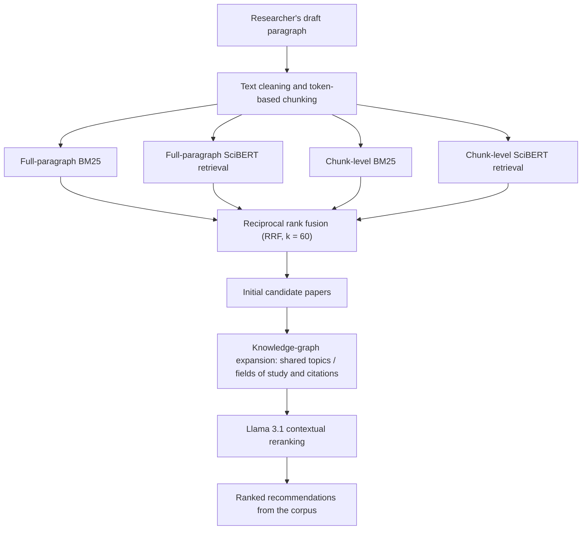
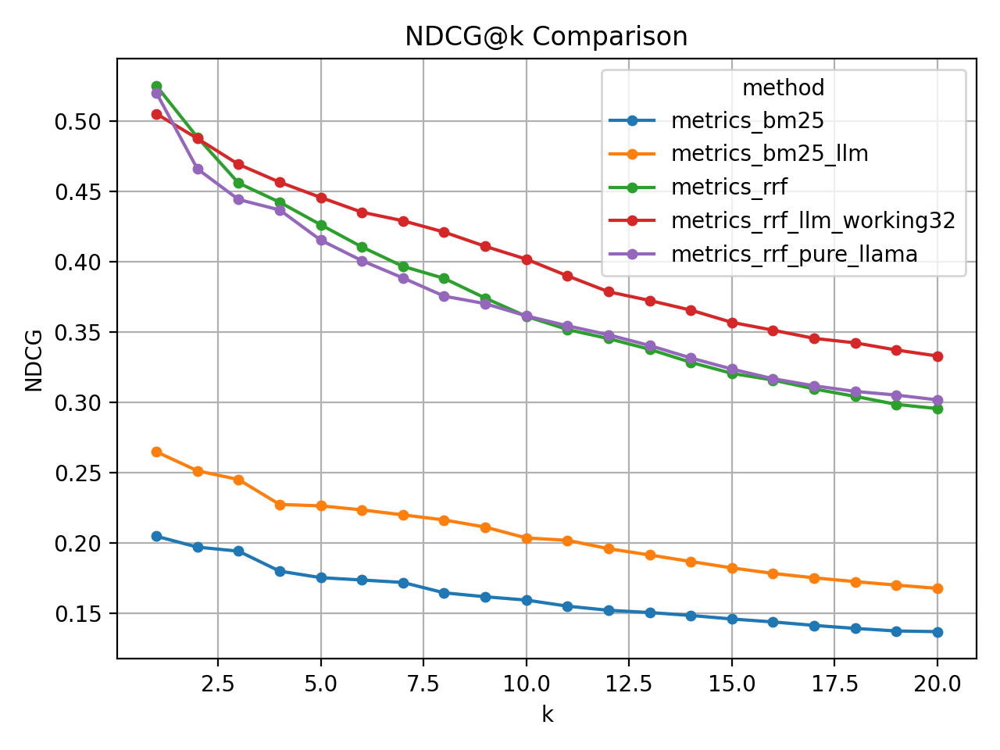
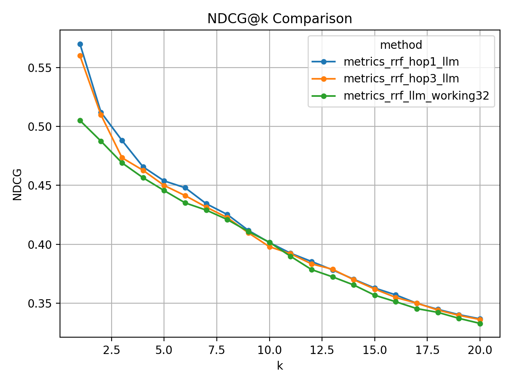

# INSPIRE — Context-Aware Scholarly Paper Recommendation

**INSPIRE** is a research prototype for recommending academic papers from a paragraph that a researcher is currently writing. Rather than treating a short keyword query as a fixed description of interest, it uses the draft itself as a signal of the researcher's changing information needs.

The system combines **hybrid retrieval (BM25 + SciBERT)**, **reciprocal rank fusion (RRF)**, **knowledge-graph-based candidate expansion**, and **LLM reranking**. Recommendations are selected from an existing paper corpus; the LLM does not generate or invent paper records.

> **Project status:** Research code and evaluation artifacts are available, but this is not a packaged or hosted application. Reproducing the full pipeline requires the source corpus, generated embeddings, a populated Neo4j database, and access to the language model.

## How it works



### 1. Hybrid retrieval

Four retrieval signals are combined:

- **Full-paragraph BM25:** lexical matches between the draft and indexed paper text.
- **Full-paragraph SciBERT:** embedding-based retrieval for semantic similarity.
- **Chunk-level BM25:** lexical matches for smaller portions of a draft.
- **Chunk-level SciBERT:** semantic matches for those smaller portions.

The results are merged with **reciprocal rank fusion**, using a default constant of `k = 60`. This provides candidate papers without depending on one retrieval strategy alone.

### 2. Knowledge-graph expansion

A heterogeneous graph in **Neo4j** represents three node types: `Paper`, `Topic`, and `FieldOfStudy`. Its relationships include `CITES`, `HAS_TOPIC`, and `HAS_FOS`.

The implemented expansion searches for papers connected to the initial candidates through **shared topics or fields of study** and **incoming/outgoing citation links**. It prioritizes candidates found through both kinds of connections. A further topic-hop expansion is present in the code but is currently commented out.

This stage is intended to help find relevant papers that may be missed by direct lexical or embedding similarity, including potentially useful *bridge papers* across related topics.

### 3. LLM reranking

The expanded candidate set is reranked against the original draft using **Meta-Llama-3.1-8B-Instruct**. The implementation uses 4-bit quantization through `bitsandbytes` and processes candidates in small batches/windows to produce contextual relevance scores.

The final rankings are grounded in retrieved paper IDs and their metadata.

## Data and evaluation

The pipeline is designed around **DBLP v12** scholarly publication data, including titles, abstracts, references, publication years, and fields of study. SciBERT embeddings and BERTopic-derived topics are used to prepare the retrieval indexes and knowledge graph.

The repository includes sample evaluation datasets under [`datasets/`](datasets/) and saved results under [`main/llm/csv_final/`](main/llm/csv_final/).

Evaluation scripts compare BM25-only, RRF-based retrieval, LLM reranking, and graph-expansion variants. They report:

| Metric | Meaning |
| --- | --- |
| **Precision@k (P@k)** | Fraction of the first `k` recommendations marked relevant |
| **Hit Rate@k (HR@k)** | Whether at least one relevant recommendation appears in the first `k` |
| **Recall@k (R@k)** | Fraction of reference papers recovered within the first `k` |
| **NDCG@k** | Ranking quality that rewards relevant results appearing earlier |

The evaluation code calculates these metrics for **k = 1–20**. Its matching procedure uses SciBERT abstract similarity (with a configured threshold of `0.95`) to associate recommended papers with held-out references; the reported metrics should therefore be interpreted as **proxy-based evaluation**, rather than direct human relevance judgments. The scripts also use a 2020-paper holdout convention.

### Evaluation visualizations





Additional precision, recall, and hit-rate plots are available in [`main/llm/eval_final/`](main/llm/eval_final/).

## Repository structure

| Path | Contents |
| --- | --- |
| [`main/embedding/`](main/embedding/) | SciBERT embeddings for papers and fields of study; experimental HNSW indexing |
| [`main/topicModeling/`](main/topicModeling/) | BERTopic-based topic modeling |
| [`main/knowledgeGraph/`](main/knowledgeGraph/) | Neo4j graph export, graph embeddings, and visualizations |
| [`main/llm/recall.py`](main/llm/recall.py) | BM25/vector retrieval, chunk retrieval, RRF fusion, and metadata lookup |
| [`main/llm/hop_reasoning.py`](main/llm/hop_reasoning.py) | Topic/field-of-study and citation-based graph expansion |
| [`main/llm/rerank_llm.py`](main/llm/rerank_llm.py) | Llama-based candidate scoring and sliding-window reranking |
| [`main/llm/eval_*.py`](main/llm/) | Evaluation experiments and baselines |
| [`main/llm/prompts/`](main/llm/prompts/) | Reranking prompt templates |
| [`datasets/`](datasets/) | Evaluation JSONL files and selected dataset metadata |
| [`explanation /neo4j_command.txt`](explanation%20/neo4j_command.txt) | Original Neo4j import and index-creation notes |

## Getting started

### 1. Clone the repository

```bash
git clone https://github.com/Manami108/recommender-system.git
cd recommender-system

python3 -m venv .venv
source .venv/bin/activate
```

For Windows PowerShell, activate the environment with `.venv\Scripts\Activate.ps1` instead.

There is currently no pinned `requirements.txt`. For the retrieval and evaluation scripts, the main Python dependencies include:

```bash
python -m pip install numpy pandas matplotlib neo4j sentence-transformers transformers nltk torch
```

Additional stages use `bertopic`, `scikit-learn`, `tqdm`, `hnswlib` (experimental indexing), and `accelerate` / `bitsandbytes` (LLM inference). Install the packages needed for the particular stage you want to run.

### 2. Prepare the data and Neo4j indexes

The full DBLP source corpus, derived embeddings, and populated graph are **not** provided as a ready-to-run database in this repository. To reproduce the experiments:

1. Obtain and preprocess the DBLP v12 corpus into the formats expected by the scripts.
2. Generate paper and field-of-study embeddings using `main/embedding/`; prepare topics with `main/topicModeling/`.
3. Update the machine-specific input/output paths in the preparation scripts.
4. Export the graph data using `main/knowledgeGraph/neo4j.py`, import it into Neo4j, and create the `paper_fulltext` and `paper_vec` indexes.

The original commands and Cypher definitions are documented in [`explanation /neo4j_command.txt`](explanation%20/neo4j_command.txt). **Review them carefully:** the original database-import instructions include destructive operations and local filesystem paths. Do not run those commands unchanged against an existing database.

Set your database connection through environment variables instead of storing credentials in source files:

```bash
export NEO4J_URI="bolt://localhost:7687"
export NEO4J_USER="neo4j"
export NEO4J_PASS="<your-password>"
```

### 3. Run a retrieval evaluation

After the Neo4j graph and indexes are ready, you can run the **RRF baseline** against one of the included JSONL test sets:

```bash
TESTSET_PATH="$PWD/datasets/testset1.jsonl" MAX_CASES=5 python main/llm/eval_rrf.py
```

The scripts currently use a Llama 3.1 tokenizer even in some non-LLM evaluations; access to the corresponding Hugging Face model may therefore be required. The LLM reranking experiments additionally require access to the Llama weights and an appropriate GPU environment for 4-bit inference.

**Before running LLM evaluation scripts**, review their machine-specific paths and email-notification configuration. Some are experiment-specific scripts, not general-purpose entry points, and need adjustment for a new environment.

## Limitations and next steps

- **Reproducibility:** central datasets, precomputed artifacts, and Neo4j graph state must be prepared separately; dependency versions are not pinned.
- **Portability:** some scripts contain absolute paths and experimental configuration values from the original environment.
- **Graph reasoning:** shared-topic/field-of-study and citation expansion are implemented; deeper topic-hop traversal remains experimental.
- **Evaluation:** abstract-similarity matching is a proxy for relevance, not a substitute for expert review or a user study.
- **Deployment:** there is no web interface or unified inference CLI yet.

Future improvements include a reproducible configuration and setup process, stronger graph-expansion experiments, and broader human-centered evaluation of recommendation usefulness during writing.

## License

This project is released under the [MIT License](LICENSE).
